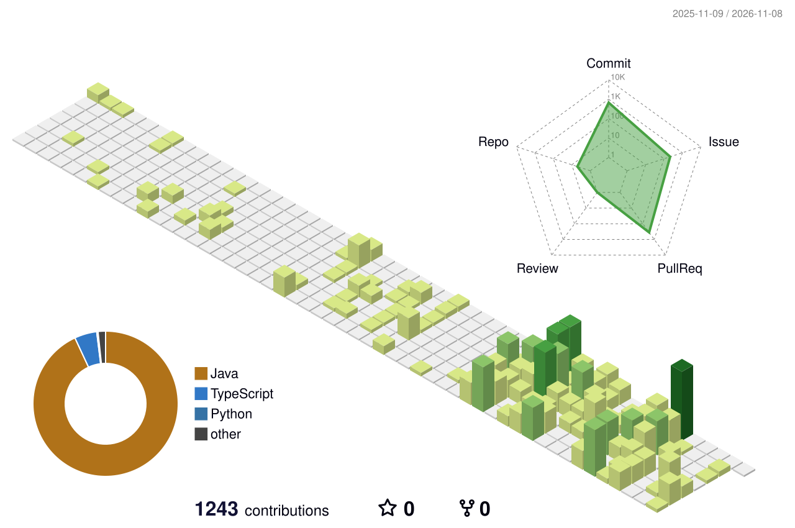

AI 백엔드 개발자를 공부하고 있습니다.

---

## 🌟 Contact

- GitHub: [@hanmogo](https://github.com/hanmogo)

## 📒 Tech Stack

### Backend

### Collaboration & Tools

## 🌱 Contribution Graph

<picture>
  <source media="(prefers-color-scheme: dark)" srcset="./profile/snake-dark.svg">
  <source media="(prefers-color-scheme: light)" srcset="./profile/snake.svg">
  
</picture>

<b>기여 기록을 3D 잔디로 보기</b>

 
<picture>
  <source media="(prefers-color-scheme: dark)" srcset="./profile-3d-contrib/profile-night-green.svg">
  <source media="(prefers-color-scheme: light)" srcset="./profile-3d-contrib/profile-green.svg">
  
</picture>

 

<picture>
  <source media="(prefers-color-scheme: dark)" srcset="./profile/stats-dark.svg">
  
</picture>
<picture>
  <source media="(prefers-color-scheme: dark)" srcset="./profile/top-langs-dark.svg">
  
</picture>

##  Contribute

- UMC 8th 울산대학교 Backend Developer
- UMC 9th 울산대학교 Backend Developer

